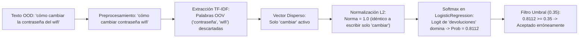

# Auditoría y Conjuntos de Evaluación Fuera de Dominio (OOD)

Este documento detalla la auditoría del comportamiento Fuera de Dominio (*Out-of-Domain* o OOD) del clasificador de intenciones para la tienda de ropa, la metodología de curaduría de los datasets de validación y prueba, y las limitaciones intrínsecas del pipeline actual basado en TF-IDF y Regresión Logística.

---

## 1. Auditoría del Problema OOD Confirmado (Root Cause Analysis)

### 1.1 El Fallo Reportado
Durante las pruebas de inferencia se confirmaron tres asignaciones espurias con alta confianza en consultas totalmente ajenas al dominio textil:

| Consulta | Intención Predicha | Confianza ($P_{\max}$) | Umbral Actual | Resultado Inferencia |
| :--- | :--- | :---: | :---: | :---: |
| `"cómo cambiar la contraseña del wifi"` | `devoluciones` | **0.8112** | 0.35 | **Falso Aceptado** |
| `"tengo fiebre y dolor de cabeza"` | `consultar_tallas` | **0.6390** | 0.35 | **Falso Aceptado** |
| `"¿cuánto cuesta un pasaje de avión?"` | `consultar_precio` | **0.6825** | 0.35 | **Falso Aceptado** |

En los tres casos, la predicción supera holgadamente el umbral de aceptación ($0.35$), por lo que el sistema clasifica erróneamente la consulta en lugar de marcarla como `no_entendido`.

---

### 1.2 Causa Raíz Técnica y Matemática

La causa fundamental del problema reside en la combinación de cuatro factores arquitecturales en el pipeline:

1. **Ceguera léxica OOV (*Out-of-Vocabulary Blindness*):**
   El vectorizador TF-IDF entrena un vocabulario fijo (hasta 2.000 unigramas y bigramas) derivado exclusivamente del corpus de la tienda de ropa. Cuando el usuario envía una frase fuera de dominio, las palabras indicativas del dominio real (*"contraseña"*, *"wifi"*, *"fiebre"*, *"dolor"*, *"cabeza"*, *"pasaje"*, *"avión"*) no existen en el vocabulario (`vocabulary_`). El vectorizador las descarta de manera silenciosa asignándoles un peso nulo ($0.0$).

2. **Normalización L2 en vectores dispersos:**
   El vectorizador aplica normalización de norma Euclidiana ($L_2$). Al quedar únicamente un término coincidente en el vocabulario (ej. *"cambiar"* o *"costar"*), el vector resultante $\mathbf{x}$ satisface $\|\mathbf{x}\|_2 = 1.0$. Por consiguiente:
   $$\mathbf{x}_{\text{"cómo cambiar la contraseña del wifi"}} \equiv \mathbf{x}_{\text{"cambiar"}}$$
   $$\mathbf{x}_{\text{"tengo fiebre y dolor de cabeza"}} \equiv \mathbf{x}_{\text{"tener"}}$$
   $$\mathbf{x}_{\text{"¿cuánto cuesta un pasaje de avión?"}} \equiv \mathbf{x}_{\text{"costar"}}$$
   El clasificador recibe exactamente el mismo vector representativo que si el usuario hubiera escrito una sola palabra clave pura.

3. **Sobreconfianza de Softmax (*Softmax Overconfidence*):**
   La regresión logística multinomial calcula las probabilidades mediante la función softmax:
   $$P(y = c \mid \mathbf{x}) = \frac{e^{\mathbf{w}_c^T \mathbf{x} + b_c}}{\sum_{k=1}^K e^{\mathbf{w}_k^T \mathbf{x} + b_k}}$$
   Softmax mide la certidumbre *relativa* entre las clases conocidas, no la distancia *absoluta* respecto a la distribución de entrenamiento. Dado que el lema *"cambiar"* tiene coeficientes fuertemente positivos para `devoluciones` y negativos o cercanos a cero para el resto de las clases, el término correspondiente en el exponente se amplifica, resultando en una probabilidad artificialmente elevada ($>0.81$).

4. **Inadecuación del umbral escalar sobre $P_{\max}$:**
   Con 13 clases balanceadas, la probabilidad uniforme aleatoria es $\frac{1}{13} \approx 0.077$. Un umbral estático de $0.35$ únicamente filtra consultas completamente silenciosas (vector todo ceros, cuya probabilidad máxima oscila entre $0.10$ y $0.24$), pero es permeable ante cualquier frase que contenga tan solo un lema discriminativo en común.

---

## 2. Conjuntos de Datos OOD Creados

Para permitir el diseño, la calibración rigurosa de umbrales y la posterior evaluación honesta de detectores OOD, se han construido dos conjuntos de datos independientes y estrictamente disjuntos:

### 2.1 Resumen Cuantitativo

| Conjunto | Ruta | N° Muestras | Fáciles | Difíciles | Categorías | Propósito |
| :--- | :--- | :---: | :---: | :---: | :---: | :--- |
| **Validación / Calibración** | `data/ood_val.csv` | **40** | 20 (50%) | 20 (50%) | 19 | Selección de hiperparámetros y calibración del umbral o detector OOD |
| **Prueba / Evaluación Final** | `data/ood_test.csv` | **50** | 25 (50%) | 25 (50%) | 30 | Evaluación final imparcial del pipeline (incluye los 3 reportes del bug) |

### 2.2 Estructura de las Columnas
Ambos archivos siguen el formato estándar CSV (codificación UTF-8 sin BOM):
- `texto`: La consulta o frase en lenguaje natural (español).
- `categoria`: El ámbito semántico real no relacionado con la tienda (e.g., `salud`, `tecnologia`, `finanzas`, `ciencia`, `vehiculos`, `gastronomia`, `deportes`, `tramites`).
- `dificultad`:
  - `facil`: Casos sin palabras clave o lemas dominantes del catálogo de la tienda (su vector TF-IDF tiende a cero o contiene únicamente términos no polarizados).
  - `dificil`: Casos adversarios con solapamiento léxico de verbos o sustantivos de tienda aplicados a contextos no textiles (*"cambiar"*, *"precio"*, *"costar"*, *"envíos"*, *"devolución"*, *"talla"*, *"stock"*, *"venden"*, *"horario"*, *"pago"*).
- `fuente`:
  - `curada_manual`: Diseñada y auditada manualmente por el equipo de ingeniería.
  - `bug_report`: Casos reales reportados como fallas en producción.

---

## 3. Justificación de la Partición Val/Test y Prevención de Fugas (*Data Leakage*)

1. **Independencia Estricta:**
   - La intersección de textos entre `ood_val.csv` y `ood_test.csv` es **$0$**.
   - La intersección con el dataset de entrenamiento `data/raw/intenciones.csv` es **$0$**.
   - La intersección con las 4 frases históricas de `tests/test_models.py` es **$0$**.
2. **Aislamiento de los Casos de Bug:**
   Las 3 frases del bug reportado (`"cómo cambiar la contraseña del wifi"`, `"tengo fiebre y dolor de cabeza"`, `"¿cuánto cuesta un pasaje de avión?"`) se ubicaron **únicamente** en `ood_test.csv`. Esto asegura que los mecanismos de rechazo que se calibren con `ood_val.csv` demuestren capacidad de generalización genuina sin haber memorizado los ejemplos específicos de la falla.
3. **Distribución Homogénea:**
   Ambos conjuntos mantienen una proporción exacta del 50% de casos fáciles y 50% de casos difíciles para evitar sesgos de evaluación.

---

## 4. Resultados de la Auditoría Empírica con el Modelo Actual

Evaluación del modelo en producción (`artifacts/modelo.joblib` con umbral actual $0.35$):

### Conjunto de Validación (`data/ood_val.csv`, $N=40$)
- **Tasa global de rechazo correcto:** 25/40 (**62.5%**)
- **Falsos Aceptados (Error OOD):** 15/40 (**37.5%**)
  - Subconjunto `facil` ($N=20$): 18/20 rechazados (**90.0%**), probabilidad media = $0.202$
  - Subconjunto `dificil` ($N=20$): solo 7/20 rechazados (**35.0%**), **65.0% de error**, probabilidad media = $0.599$ (máximo $0.997$)

### Conjunto de Prueba (`data/ood_test.csv`, $N=50$)
- **Tasa global de rechazo correcto:** 30/50 (**60.0%**)
- **Falsos Aceptados (Error OOD):** 20/50 (**40.0%**)
  - Subconjunto `facil` ($N=25$): 23/25 rechazados (**92.0%**), probabilidad media = $0.189$
  - Subconjunto `dificil` ($N=25$): solo 7/25 rechazados (**28.0%**), **72.0% de error**, probabilidad media = $0.595$ (máximo $0.977$)

### Hallazgo Clave
Mientras que las frases OOD sin coincidencias léxicas se rechazan satisfactoriamente ($>90\%$), las frases con solapamiento léxico sufren una tasa de falso positivo del **$65\% - 72\%$**. El modelo confunde la presencia de un lema aislado con la pertenencia temática de toda la frase.

---

## 5. Limitaciones Intrínsecas del Enfoque TF-IDF Disperso

Para los desarrolladores y agentes que diseñen el detector OOD, es imperativo reconocer los límites matemáticos del espacio vectorial disperso:

1. **Inexistencia de Distancia Semántica Continua:**
   A diferencia de los modelos basados en representaciones densas (*dense embeddings* como BERT, RoBERTa o Word2Vec), un espacio TF-IDF disperso no modela similitud semántica. Si una palabra OOD no está en el vocabulario, su distancia coseno contra cualquier clase es geométricamente equivalente a cero.
2. **Sensibilidad Extrema a Palabras Polisémicas:**
   Verbos como *"cambiar"*, *"costar"*, *"pagar"*, *"enviar"* y sustantivos como *"talla"*, *"precio"*, *"reembolso"* tienen un significado amplio en el lenguaje natural. Sin información contextual densa, una sola palabra domina el cálculo de los logits.
3. **Frases Cortas vs. Frases Complejas:**
   En frases de 2 o 3 palabras (e.g. *"cambiar pantalla"*), el ratio de cobertura de vocabulario no siempre es suficiente para discernir la intención. Por el contrario, en frases largas OOD (e.g. *"solicito la devolución del depósito de garantía del contrato de arrendamiento"*), el 85% de las palabras son OOV, lo que ofrece una señal nítida que puede ser aprovechada mediante métricas de cobertura léxica o ratio OOV.
4. **Recomendación para Mejoras del Detector:**
   Para solucionar los fallos detectados sin reentrenar arquitecturas complejas de redes neuronales, se recomienda explorar en la fase de inferencia:
   - Medir el **ratio de palabras fuera de vocabulario (OOV ratio)** antes o después de la vectorización. Si más del $50\%$ de los tokens de contenido son OOV, la consulta debe forzarse a `no_entendido`.
   - Evaluar la **norma $L_1$ del vector disperso no normalizado** o la cantidad de características activas ($k_{\text{activas}}$).
   - Analizar la **entropía de la distribución de probabilidad** o elevar el umbral de aceptación calibrándolo en `ood_val.csv`.
