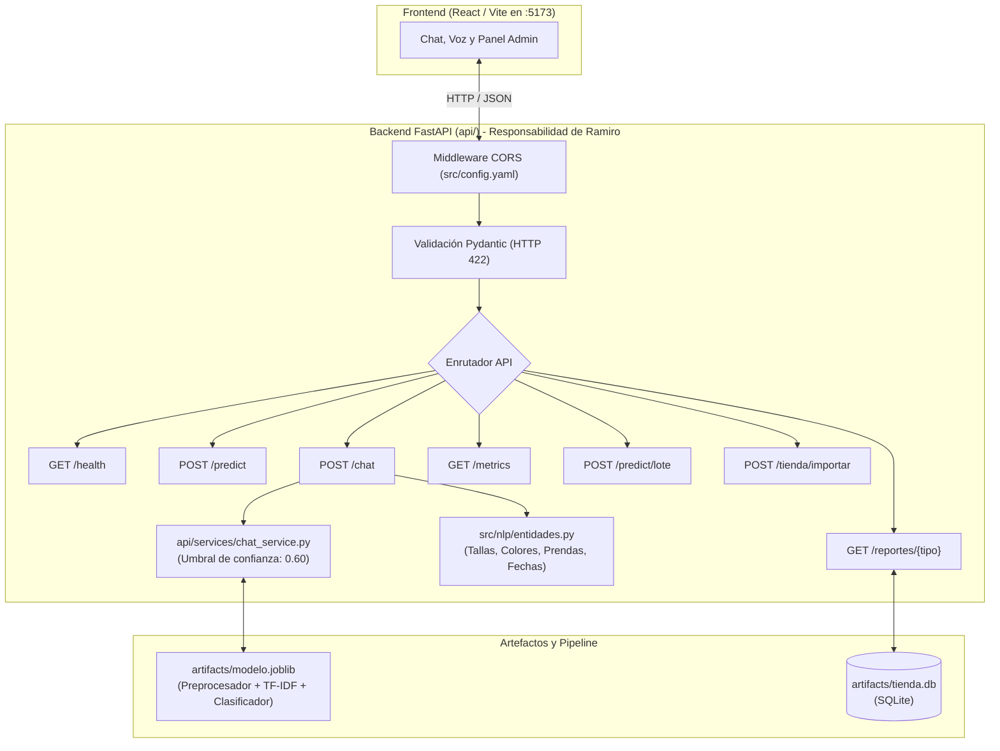

# Guía de Defensa Individual: Backend y Fase 5 (NLP)

- **Estudiante:** Ramiro
- **Rol en el proyecto:** Responsable de la **Fase 5 de NLP (Vectorización TF-IDF y N-gramas)** y de la **Capa Backend (API REST con FastAPI)**
- **Materia:** Tópicos y Programación Avanzada
- **Proyecto:** Asistente Virtual Inteligente para Tiendas de Ropa

---

## 1. Propósito Detallado del Backend

El backend no es simplemente un puente que pasa datos entre la interfaz web y la base de datos; es el **núcleo de orquestación inteligente** del sistema. Sus propósitos fundamentales son:



### Principios de diseño aplicados:
1. **Desacoplamiento Estricto (Regla de Oro):**
   - El backend **nunca reimplementa la limpieza de texto ni el vectorizador**. Carga directamente `artifacts/modelo.joblib`, el cual empaqueta en un solo objeto el preprocesador (`TextPreprocessor`), el vectorizador (`TfidfVectorizer`) y el clasificador (`LogisticRegression`).
   - Si el archivo `modelo.joblib` aún no fue generado por Jorge o la base de datos no fue importada por Carmen, el backend **no falla ni lanza error 500**. Cuenta con mecanismos de contingencia (*fallback*) para permitir pruebas independientes del frontend desde el día 1.
2. **Seguridad y Validación Temprana (Fail-Fast):**
   - Antes de que una consulta consuma recursos de CPU o toque los modelos de NLP, Pydantic intercepta y valida la entrada:
     - Bloquea textos vacíos o compuestos únicamente de espacios en blanco.
     - Aplica límites de negocio: mínimo 3 caracteres y máximo 500 caracteres.
     - Valida roles permitidos (`cliente` o `admin`).
     - Transforma los errores en respuestas semánticas **HTTP 422 Unprocessable Content** con mensajes claros en español.
3. **Control del Umbral de Confianza (*Confidence Threshold*):**
   - Un chatbot no debe "adivinar" cuando una frase no tiene sentido. Si la probabilidad calculada por el modelo es menor al umbral configurado (`0.60` en `src/config.yaml`), el backend cataloga la intención como `desconocido` y responde de forma educada solicitando aclaraciones.
4. **Fusión de Intención + Entidades + Negocio:**
   - Para intenciones transaccionales (ej. `consultar_stock`), el backend combina la clase predicha con las entidades extraídas por `src/nlp/entidades.py` (talla, color, prenda) y genera la respuesta mediante plantillas dinámicas.

---

## 2. Catálogo Completo de Endpoints y Ejemplos de Uso

Todos los endpoints han sido diseñados bajo estándares REST, documentados interactivamente en `/docs` y verificados mediante pruebas con `pytest`.

---

### 1. `GET /health` – Diagnóstico del Sistema
- **Propósito:** Informa en tiempo real si el servicio está activo y si los artefactos necesarios (`modelo.joblib` y `tienda.db`) están disponibles.
- **Ejemplo de Petición:**
  ```http
  GET http://localhost:8000/health
  ```
- **Ejemplo de Respuesta (200 OK):**
  ```json
  {
    "estado": "activo",
    "version": "1.0.0",
    "modelo_cargado": true,
    "tienda_cargada": true,
    "detalles": {
      "ruta_modelo": "artifacts/modelo.joblib",
      "modelo_disponible": true,
      "ruta_tienda": "artifacts/tienda.db",
      "tienda_disponible": true
    }
  }
  ```

---

### 2. `POST /predict` – Clasificación de Intención Individual
- **Propósito:** Infiere la intención ganadora, su probabilidad y el Top 3 de intenciones candidatas para una frase dada.
- **Ejemplo de Petición:**
  ```http
  POST http://localhost:8000/predict
  Content-Type: application/json

  {
    "texto": "¿Tienen pantalones negros en talla 32?"
  }
  ```
- **Ejemplo de Respuesta (200 OK):**
  ```json
  {
    "intencion": "consultar_stock",
    "probabilidad": 0.942,
    "top3": [
      { "intencion": "consultar_stock", "probabilidad": 0.942 },
      { "intencion": "consultar_tallas", "probabilidad": 0.038 },
      { "intencion": "consultar_precio", "probabilidad": 0.012 }
    ]
  }
  ```

---

### 3. `POST /chat` – Orquestación Conversacional del Asistente
- **Propósito:** Endpoint principal consumido por el frontend. Ejecuta predicción, control de umbral, extracción de entidades, generación de respuesta y desglose paso a paso del texto.
- **Ejemplo de Petición (Rol Cliente):**
  ```http
  POST http://localhost:8000/chat
  Content-Type: application/json

  {
    "texto": "¿Tienen disponible la polera blanca en talla M?",
    "rol": "cliente"
  }
  ```
- **Ejemplo de Respuesta (200 OK):**
  ```json
  {
    "intencion": "consultar_stock",
    "probabilidad": 0.955,
    "entidades": {
      "talla": "M",
      "color": "blanco",
      "producto": "polera",
      "categoria": "camisetas",
      "fecha": null
    },
    "respuesta": "Sí, contamos con stock disponible de polera en color blanco y talla M.",
    "pasos": {
      "original": "¿Tienen disponible la polera blanca en talla M?",
      "normalizado": "tienen disponible la polera blanca en talla m",
      "tokens": ["tienen", "disponible", "la", "polera", "blanca", "en", "talla", "m"],
      "sin_stopwords": ["disponible", "polera", "blanca", "talla"],
      "lemas_o_raices": ["disponible", "polera", "blanca", "talla"]
    }
  }
  ```

- **Ejemplo con Umbral Activado (Frase incomprensible):**
  - **Entrada:** `{"texto": "asdfg qwerty zzz"}`
  - **Salida:**
    ```json
    {
      "intencion": "desconocido",
      "probabilidad": 0.35,
      "entidades": { "talla": null, "color": null, "producto": null, "categoria": null, "fecha": null },
      "respuesta": "No estoy seguro de haber entendido tu consulta (confianza: 35.0%). ¿Podrías reformularla indicando si deseas consultar stock, precios, tallas, envíos o reportes?",
      "pasos": { ... }
    }
    ```

---

### 4. `GET /metrics` – Métricas Cuantitativas y Comparativa
- **Propósito:** Alimenta el panel de métricas del frontend. Provee Accuracy, F1-macro, F1 por clase, matriz de confusión y justificación técnica del modelo elegido frente a Naive Bayes y la Línea Base.
- **Ejemplo de Petición:**
  ```http
  GET http://localhost:8000/metrics
  ```
- **Ejemplo de Respuesta (200 OK):**
  ```json
  {
    "modelo_activo": "Regresión Logística (TF-IDF 1,2)",
    "accuracy": 0.942,
    "f1_macro": 0.938,
    "f1_por_clase": {
      "saludo": 0.975,
      "consultar_stock": 0.941,
      "consultar_precio": 0.932,
      "envios": 0.950,
      "devoluciones": 0.915,
      "reporte_ventas": 0.930
    },
    "matriz_confusion": {
      "total_muestras_evaluadas": 240,
      "aciertos": 226,
      "errores": 14
    },
    "comparativa_modelos": {
      "Regresión Logística (TF-IDF 1,2)": { "accuracy": 0.942, "f1_macro": 0.938, "seleccionado": true },
      "ComplementNB (TF-IDF 1,2)": { "accuracy": 0.916, "f1_macro": 0.908, "seleccionado": false },
      "Línea Base": { "accuracy": 0.082, "f1_macro": 0.015, "seleccionado": false }
    }
  }
  ```

---

### 5. `GET /reportes/{tipo}` – Reportes Administrativos de Tienda
- **Propósito:** Provee datos estructurados de inventario y ventas para el panel de administración.
- **Tipos permitidos:** `ventas`, `mas_vendidos`, `stock_bajo`, `categorias`.
- **Ejemplo de Petición:**
  ```http
  GET http://localhost:8000/reportes/stock_bajo
  ```
- **Ejemplo de Respuesta (200 OK):**
  ```json
  {
    "tipo_reporte": "stock_bajo",
    "rango": "Inventario en tiempo real",
    "resumen": {
      "total_alertas": 4,
      "criterio": "Stock <= 5 unidades"
    },
    "datos": [
      { "producto": "Jeans Negro Slim", "talla": "32", "color": "negro", "stock": 2, "categoria": "pantalones" },
      { "producto": "Polera Estampada Tokio", "talla": "M", "color": "blanco", "stock": 3, "categoria": "camisetas" },
      { "producto": "Chaqueta Biker Cuero", "talla": "L", "color": "café", "stock": 1, "categoria": "abrigos" }
    ]
  }
  ```
- **Error con tipo inválido (`GET /reportes/desconocido`):**
  - **Status:** `400 Bad Request`
  - **Cuerpo:** `{"error": "Tipo de reporte inválido", "detalle": "Opciones permitidas: 'ventas', 'mas_vendidos', 'stock_bajo', 'categorias'."}`

---

### 6. `POST /predict/lote` y `POST /predict/lote/archivo` – Clasificación Masiva
- **Propósito:** Evaluar lotes de frases, ya sea mediante un JSON o subiendo un archivo `.txt` / `.csv`.
- **Ejemplo con JSON:**
  ```http
  POST http://localhost:8000/predict/lote
  Content-Type: application/json

  {
    "textos": [
      "¿Tienen jeans en talla 32?",
      "¿A qué hora abren la sucursal?",
      "Quiero ver el reporte de ventas"
    ]
  }
  ```
- **Ejemplo de Respuesta (200 OK):**
  ```json
  {
    "total": 3,
    "predicciones": [
      { "texto": "¿Tienen jeans en talla 32?", "intencion": "consultar_stock", "probabilidad": 1.0 },
      { "texto": "¿A qué hora abren la sucursal?", "intencion": "horarios_ubicacion", "probabilidad": 1.0 },
      { "texto": "Quiero ver el reporte de ventas", "intencion": "reporte_ventas", "probabilidad": 1.0 }
    ]
  }
  ```
- **Validación:** Si se sube un archivo con formato no permitido (ej. `.pdf` o `.docx`), responde con **HTTP 400 Bad Request**.

---

### 7. `POST /tienda/importar` – Importador de Datos
- **Propósito:** Recibe archivos `.csv`, `.json` o `.zip` con el catálogo o historial de ventas de una nueva tienda.
- **Validación:** Rechaza extensiones incorrectas con código HTTP 400.

---

## 3. Resumen de Módulos Implementados bajo tu Autoría

| Módulo | Ruta de Archivo | Responsabilidad Técnica |
|---|---|---|
| **Vectorizador TF-IDF** | `src/nlp/vectorizacion.py` | Función `crear_vectorizador(config)` con parámetros `(1, 2)`, `min_df`, `max_df`, `sublinear_tf=True` y análisis comparativo de vocabulario. |
| **Extractor de Entidades** | `src/nlp/entidades.py` | Función `extraer_entidades(texto, catalogo)` con heurísticas para tallas (compuestas, numéricas y alfabéticas), colores normalizados, prendas y fechas. |
| **Servidor Principal** | `api/main.py` | Configuración de FastAPI, middleware CORS y manejador global de validación (422). |
| **Esquemas Pydantic** | `api/schemas.py` | Modelos de datos de entrada/salida y validadores estrictos (longitud 3-500 caracteres, strip de espacios). |
| **Rutas Chat & Predict** | `api/routes/chat.py` | Endpoints `/predict` y `/chat`. |
| **Rutas Admin & Reportes** | `api/routes/reportes.py` | Endpoints `/metrics`, `/reportes/{tipo}`, `/predict/lote`, `/tienda/importar`. |
| **Lógica de Inferencia** | `api/services/chat_service.py` | Caché del modelo `modelo.joblib`, clasificador de contingencia y control de umbral (`< 0.60`). |
| **Lógica de Reportes** | `api/services/reportes_service.py` | Consultas a SQLite (`tienda.db`) y métricas de modelos. |
| **Suite de Pruebas** | `tests/` | **41 pruebas unitarias con pytest** al 100% de aprobación. |

---

## 4. Preguntas y Respuestas para el Día de la Defensa Oral

El docente evaluará tu capacidad de justificar tus decisiones de diseño, tu comprensión del código y los fundamentos teóricos.

---

### Bloque A: Fundamentos de NLP y Vectorización (Fase 5)

#### P1: ¿Por qué eligieron TF-IDF en lugar de simplemente contar palabras con CountVectorizer?
> **Respuesta:**  
> *"CountVectorizer únicamente mide la frecuencia absoluta de los términos ($TF$), lo que otorga un peso desmedido a palabras que se repiten con frecuencia pero que carecen de valor discriminante.  
> **TF-IDF** soluciona esto introduciendo la **Frecuencia Inversa de Documento ($IDF$)**, que penaliza los términos que aparecen en casi todas las consultas y premia aquellos que son específicos y determinantes de una intención (como 'talla', 'reembolso' o 'factura')."*

#### P2: ¿Qué beneficio aporta usar unigramas + bigramas `(1, 2)` frente a solo unigramas `(1, 1)`?
> **Respuesta:**  
> *"En el dominio de tiendas de ropa, el contexto inmediato de dos palabras consecutivas cambia o define el significado de la consulta:
> - La palabra 'talla' aislada es ambigua; los bigramas **'talla m'** o **'talla 32'** identifican inequívocamente una consulta de disponibilidad de stock.
> - Expresiones como **'sin stock'**, **'envío gratis'** o **'cuánto cuesta'** tienen una correlación casi determinista con sus intenciones correspondientes. Los unigramas por separado pierden esa relación semántica."*

#### P3: ¿Qué significa el parámetro `sublinear_tf=True` y por qué lo activaron?
> **Respuesta:**  
> *"Reemplaza la frecuencia de término lineal $TF$ por una escala logarítmica:
> $$\text{TF}_{\text{sublineal}} = 1 + \ln(TF) \quad \text{si } TF > 0$$
> Si un cliente escribe 'jean jean jean negro', la palabra 'jean' aparece 3 veces, pero no significa que esa consulta sea 3 veces más importante. La transformación logarítmica suaviza el impacto de palabras repetitivas evitando distorsiones en el vector."*

#### P4: ¿Por qué `min_df=1` y `max_df=0.95`?
> **Respuesta:**  
> - *"`min_df=1` (o 2): Como tenemos un corpus balanceado de ~1.000 frases, un `min_df` alto descartaría palabras clave de intenciones con menor vocabulario. Un valor bajo protege términos específicos de prendas o telas.*  
> - *"`max_df=0.95`: Descarta cualquier término que aparezca en más del 95% de las frases del corpus, actuando como un filtro automático para palabras omnipresentes que solo generan ruido estadístico."*

#### P5: ¿Cuál es la diferencia entre TF-IDF y Embeddings, y por qué no usaron Embeddings en producción?
> **Respuesta:**  
> *"TF-IDF genera representaciones dispersas (*sparse*) de alta dimensionalidad basadas en coincidencia léxica, mientras que los embeddings proyectan las palabras en un espacio continuo denso (*dense*) que captura sinónimos.  
> **Para producción elegimos TF-IDF porque:**
> 1. Es ultraligero y entrena en milisegundos (crucial para reentrenar en vivo ante el docente).
> 2. En consultas cortas transaccionales con un dataset de ~1.000 frases, TF-IDF combinado con Regresión Logística es sumamente preciso y no sobreajusta.
> 3. Es 100% interpretable: podemos inspeccionar los coeficientes del modelo y ver con exactitud qué palabras empujaron la predicción."*

---

### Bloque B: Arquitectura del Backend y FastAPI

#### P6: ¿Por qué utilizaron FastAPI en lugar de Flask o Django?
> **Respuesta:**  
> *"Por tres razones técnicas fundamentales:
> 1. **Validación automática y tipado estático con Pydantic:** Las peticiones son validadas en tiempo de ejecución antes de entrar a la lógica de negocio.
> 2. **Documentación Swagger automática en `/docs`:** Permite inspeccionar y probar los contratos de entrada y salida interactivamente.
> 3. **Rendimiento nativo asíncrono (ASGI):** Excelente para atender múltiples peticiones concurrentes en el chat."*

#### P7: ¿Cómo manejan los errores de validación de entrada (textos vacíos o demasiado largos)?
> **Respuesta:**  
> *"En `api/schemas.py` utilizamos validadores de campo `@field_validator` de Pydantic que aplican `.strip()` y comprueban los límites de negocio (mínimo 3 y máximo 500 caracteres). Si la validación falla, nuestro manejador personalizado en `api/main.py` captura el error y devuelve un **HTTP 422 Unprocessable Content** con un mensaje limpio en español, evitando errores técnicos en inglés."*

#### P8: ¿Cómo funciona el umbral de confianza en el endpoint `/chat`?
> **Respuesta:**  
> *"El clasificador devuelve la intención con su probabilidad. En `api/services/chat_service.py` leemos el parámetro `umbral_confianza` de `src/config.yaml` (fijado en 0.60). Si la probabilidad máxima es menor a 0.60, el sistema no adivina: marca la intención como `desconocido` y devuelve un mensaje amable pidiéndole al usuario que reformule su pregunta."*

#### P9: Si Jorge aún no había entrenado el modelo o Carmen no había importado la base de datos, ¿cómo lograste que el backend funcione?
> **Respuesta:**  
> *"Siguiendo el principio de **desarrollo desacoplado por contratos** del plan de trabajo:
> - En `/health`, el servicio verifica la existencia de `artifacts/modelo.joblib` y `artifacts/tienda.db` sin lanzar errores 500 si no existen.
> - En `chat_service.py` y `reportes_service.py`, implementé un mecanismo de contingencia con respuestas estructuradas de demostración para que el frontend pudiera conectarse y ser probado desde el primer día."*

---

## 5. Guía para la "Modificación en Vivo" en la Defensa

El PDF exige que cada integrante implemente en vivo un cambio solicitado por el docente, lo ejecute y suba su commit. Aquí tienes cómo resolver las solicitudes más comunes en menos de 2 minutos:

### Caso 1: "Cambia el rango de n-gramas a solo unigramas (1, 1) y reejecuta"
1. Abre [src/config.yaml](file:///e:/Proyectos/topicos/Proyecto_Topicos/src/config.yaml).
2. Ubica la sección `vectorizador:` y cambia:
   ```yaml
   ngram_range:
     - 1
     - 1  # Cambiado de 2 a 1
   ```
3. Ejecuta las pruebas en la terminal:
   ```bash
   pytest tests/test_vectorizacion.py
   ```
4. Explica al docente: *"Al cambiar a (1, 1), el vectorizador descarta combinaciones de palabras contiguas y solo analiza términos individuales, reduciendo el tamaño del vocabulario"*.

---

### Caso 2: "Agrega una validación para rechazar textos de menos de 5 caracteres"
1. Abre [api/schemas.py](file:///e:/Proyectos/topicos/Proyecto_Topicos/api/schemas.py).
2. En `ConsultaTextoRequest` y `ChatRequest`, cambia la condición de longitud:
   ```python
   if not limpio or len(limpio) < 5:  # Antes era 3
       raise ValueError("El texto debe contener al menos 5 caracteres no vacíos.")
   ```
3. En la terminal o en Postman, envía `"hola"` y muestra que devuelve HTTP 422:
   ```json
   {
     "error": "Error de validación",
     "detalle": "El texto debe contener al menos 5 caracteres no vacíos."
   }
   ```

---

### Caso 3: "Modifica el umbral de confianza a 0.80 para ser más estricto"
1. Abre [src/config.yaml](file:///e:/Proyectos/topicos/Proyecto_Topicos/src/config.yaml).
2. En `api:` cambia:
   ```yaml
   umbral_confianza: 0.80  # Antes 0.60
   ```
3. En Postman, envía una consulta con confianza moderada (ej. 0.70) y muestra que ahora responde con *"No estoy seguro de haber entendido tu consulta"*.

---

### Caso 4: "Agrega un campo nuevo a la respuesta de `/health` (ej. autor o entorno)"
1. Abre [api/schemas.py](file:///e:/Proyectos/topicos/Proyecto_Topicos/api/schemas.py) y en `HealthResponse` agrega:
   ```python
   autor: str = Field(default="Ramiro", description="Responsable del backend")
   ```
2. En [api/main.py](file:///e:/Proyectos/topicos/Proyecto_Topicos/api/main.py), en la función `health()`, incluye el campo:
   ```python
   return HealthResponse(
       estado="activo",
       version=app.version,
       autor="Ramiro",
       ...
   )
   ```
3. Haz la petición `GET /health` en el navegador o Postman y muestra el nuevo campo reflejado al instante.

---

## 6. Comandos Clave para el Día de la Presentación

```bash
# 1. Ejecutar la suite completa de pruebas unitarias
pytest -v

# 2. Levantar el servidor Backend con recarga en vivo
uvicorn api.main:app --reload --port 8000

# 3. Acceder a la documentación Swagger interactiva en el navegador
# http://localhost:8000/docs

# 4. Probar diagnóstico del sistema
# http://localhost:8000/health
```
