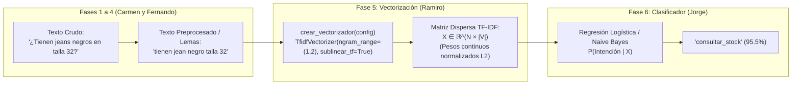

# Guía de Defensa Individual: Fase 5 de NLP (Vectorización TF-IDF y N-gramas)

- **Estudiante:** Ramiro
- **Rol en el proyecto:** Responsable de la **Fase 5 de NLP (Vectorización)** y de la **Capa Backend (FastAPI)**
- **Materia:** Tópicos y Programación Avanzada
- **Proyecto:** Asistente Virtual Inteligente para Tiendas de Ropa

---

## 1. Propósito Detallado de la Vectorización en el Pipeline

Los modelos de Machine Learning (como Regresión Logística, Naive Bayes o SVM) no procesan texto ni cadenas de caracteres de forma nativa; únicamente operan sobre **espacios vectoriales numéricos multidimensionales** ($\mathbb{R}^V$).

La **Fase 5 (Vectorización)** es el puente matemático que transforma las consultas lingüísticas preprocesadas en una matriz numérica dispersa (*sparse matrix*), donde cada columna representa un término o n-grama del vocabulario y cada celda contiene el peso de importancia de dicho término en la consulta.



### Contrato arquitectónico en el Pipeline de Scikit-Learn:
Tu módulo [src/nlp/vectorizacion.py](file:///e:/Proyectos/topicos/Proyecto_Topicos/src/nlp/vectorizacion.py) expone la función `crear_vectorizador(config)` que se ensambla directamente dentro del `Pipeline` reproducible:

```python
pipeline_produccion = Pipeline([
    ("preprocesamiento", TextPreprocessor(modo="lema")),  # Fases 1–4
    ("tfidf", crear_vectorizador(config)),                 # Fase 5 (TU MÓDULO)
    ("modelo", LogisticRegression(class_weight="balanced"))# Fase 6
])
```

---

## 2. Fundamentos Matemáticos y Fórmulas Detalladas

Durante la defensa, el docente evaluará tu dominio de las fórmulas que sustentan **TF-IDF**.

### 1. Frecuencia de Término ($TF$) – Escala Sublineal
La frecuencia de término estándar cuenta cuántas veces aparece el término $t$ en el documento $d$:
$$\text{TF}_{\text{lineal}}(t, d) = \text{count}(t, d)$$

Sin embargo, en consultas de lenguaje natural, una palabra repetida 3 veces en un mensaje no aporta el triple de significado. Por ello configuramos **`sublinear_tf=True`**, que aplica una transformación logarítmica:

$$\text{TF}_{\text{sublineal}}(t, d) = \begin{cases} 1 + \ln(\text{count}(t, d)) & \text{si } \text{count}(t, d) > 0 \\ 0 & \text{en otro caso} \end{cases}$$

*Ejemplo numérico:*
- Si la palabra *"jean"* aparece 1 vez: $\text{TF} = 1 + \ln(1) = 1.00$.
- Si la palabra *"jean"* aparece 3 veces: $\text{TF} = 1 + \ln(3) \approx 1 + 1.098 = 2.10$ (en lugar de 3.00 lineal). Se atenúa el sesgo de repetición.

---

### 2. Frecuencia Inversa de Documento ($IDF$) – Suavizado en Scikit-Learn
El $IDF$ cuantifica qué tan informativo o raro es un término a lo largo de todo el corpus $D$ ($N = |D|$ documentos). Scikit-learn utiliza la formulación suavizada para evitar divisiones entre cero y logaritmos de cero:

$$\text{IDF}(t, D) = \ln\left(\frac{1 + N}{1 + \text{df}(t)}\right) + 1$$

Donde $\text{df}(t)$ es el número de documentos donde aparece el término $t$.
- **Término común (ej. "tienda"):** Si aparece en casi todas las frases ($\text{df}(t) \approx N$), el cociente tiende a 1 y $\ln(1) = 0$, obteniendo un peso $\text{IDF} \approx 1.00$ (peso mínimo).
- **Término distintivo (ej. "reembolso" o "talla"):** Si solo aparece en 5 documentos de 1.000, el cociente es alto, resultando en un $\text{IDF} \approx 6.30$ (fuerte señal discriminante).

---

### 3. Ponderación Final TF-IDF y Normalización Euclidiana ($L_2$)
El peso crudo es el producto de ambos factores:
$$\text{TF-IDF}_{\text{crudo}}(t, d) = \text{TF}(t, d) \times \text{IDF}(t, D)$$

Para evitar que las consultas largas (con más palabras) tengan vectores con normas mayores que las consultas breves, se aplica la **normalización euclidiana $L_2$**:

$$\vec{v}_d = \frac{\vec{w}_d}{\|\vec{w}_d\|_2} = \frac{\vec{w}_d}{\sqrt{\sum_{i=1}^{|V|} w_{i,d}^2}}$$

Esto garantiza que todos los vectores resultantes tengan longitud unitaria ($\|\vec{v}_d\|_2 = 1$), permitiendo calcular similitudes geométricas justas mediante el producto punto (similitud coseno).

---

## 3. Justificación Técnica de Hiperparámetros

Todos los parámetros fueron desacoplados y centralizados en [src/config.yaml](file:///e:/Proyectos/topicos/Proyecto_Topicos/src/config.yaml) bajo la sección `vectorizador:`

| Hiperparámetro | Valor Elegido | Definición Técnica | Justificación en el Dominio (Tienda de Ropa) |
|---|:---:|---|---|
| **`ngram_range`** | **`(1, 2)`** | Extrae unigramas y bigramas contiguos. | Captura conceptos compuestos indispensables: *"talla m"*, *"talla 32"*, *"sin stock"*, *"envío gratis"*, *"cuánto cuesta"*. |
| **`min_df`** | **`1`** (o `2`) | Frecuencia mínima de documento. | En un dataset de ~1.000 frases y 13 intenciones, un valor alto eliminaría términos raros pero determinantes de intenciones con vocabulario acotado. |
| **`max_df`** | **`0.95`** | Frecuencia máxima de documento (95%). | Descarta automáticamente palabras omnipresentes que aparezcan en más del 95% de las frases, eliminando ruido no discriminante. |
| **`max_features`** | **`null`** (o `2000`) | Límite máximo de columnas del vocabulario. | El vocabulario de lemas + bigramas ronda entre 400 y 1.200 términos; no es necesario recortarlo artificialmente para no perder especificidad de prendas. |
| **`sublinear_tf`** | **`true`** | Aplica $1 + \ln(TF)$ en lugar de $TF$ lineal. | Evita que clientes que repiten la misma palabra en el chat distorsionen la norma del vector. |
| **`norm`** | **`"l2"`** | Normalización euclidiana de vectores. | Garantiza que una pregunta de 15 palabras y una de 4 palabras compitan en la misma escala métrica. |
| **`use_idf`** | **`true`** | Activa el cálculo de frecuencia inversa. | Esencial para penalizar términos comunes y premiar palabras clave determinantes. |

---

## 4. Cuadro Comparativo: CountVectorizer vs. TF-IDF vs. Embeddings

Esta tabla resume la discusión teórica de tu cuaderno `notebooks/02c_vectorizacion.ipynb` y te servirá como apoyo visual directo ante el tribunal:

| Criterio | **CountVectorizer (Bolsa de Palabras)** | **TF-IDF (Producción - Tu Elección)** | **Embeddings Semánticos (Word2Vec / spaCy / BERT)** |
|---|---|---|---|
| **Naturaleza del vector** | Dispersa (*Sparse*), números enteros (conteo). | **Dispersa (*Sparse*), números continuos normalizados.** | Densa (*Dense*), números reales continuos en todas las posiciones. |
| **Dimensión** | Igual al tamaño del vocabulario $|V|$ (~500 a 2.000). | **Igual al tamaño del vocabulario $|V|$ (~500 a 2.000).** | Dimensión fija baja (100, 300 o 768). |
| **Ponderación** | Solo cuenta frecuencia local ($TF$). | **Equilibra frecuencia local y especificidad global ($TF \times IDF$).** | Co-ocurrencia semántica en grandes corpus externos. |
| **¿Entiende sinónimos?** | No (solo coincidencia exacta de caracteres). | **No directa (depende de lematización previa).** | **Sí** (palabras similares tienen vectores geométricamente cercanos). |
| **Interpretabilidad** | Alta (sabes qué palabra se contó). | **Total:** puedes inspeccionar los coeficientes del clasificador y ver exactamente qué palabra/bigrama activó la intención. | **Baja (Caja negra):** los valores individuales de las dimensiones no tienen significado intuitivo. |
| **Tiempo de entrenamiento** | < 0.2 segundos. | **< 0.5 segundos (óptimo para modificación en vivo).** | Minutos u horas (requiere preentrenamiento o GPUs). |
| **Tamaño en disco** | < 100 KB. | **< 500 KB (ideal para API ágil y ligera).** | 45 MB a 1.5 GB según el modelo neuronal. |
| **Riesgo en frases cortas** | Alto sesgo a palabras repetidas. | **Excelente: ponderación limpia de palabras clave.** | Riesgo de **dilución semántica** al promediar todas las palabras de la frase. |

---

## 5. Banco de Preguntas y Respuestas para la Defensa Oral (Fase 5)

---

### P1: ¿Por qué en un sistema de tiendas de ropa es fundamental incluir bigramas `(1, 2)` y no quedarse solo con unigramas `(1, 1)`?
> **Respuesta Modelo:**  
> *"Porque en la atención comercial de ropa, gran parte de la semántica depende de pares de palabras contiguas:
> 1. **Pérdida de contexto:** La palabra aislada 'talla' es ambigua, pero los bigramas **'talla m'** o **'talla 32'** identifican de inmediato la disponibilidad de inventario.
> 2. **Inversión de significado:** Los términos 'stock' y 'sin' por separado no transmiten lo mismo que el bigrama **'sin stock'**.
> 3. **Frases hechas:** Expresiones como **'cuánto cuesta'** o **'envío gratis'** tienen una correlación directa con intenciones como `consultar_precio` y `envios` que los unigramas por separado diluyen."*

---

### P2: Si los embeddings capturan sinónimos y semántica mucho mejor, ¿por qué eligieron TF-IDF para este proyecto?
> **Respuesta Modelo:**  
> *"La elección de una técnica debe responder al problema y a los datos:
> 1. **Tamaño del dataset:** Contamos con un corpus de ~1.000 frases para 13 intenciones bien definidas. Con estos datos, TF-IDF combinado con Regresión Logística es el estándar de la industria: no sufre de sobreajuste y converge en milisegundos.
> 2. **Interpretabilidad académica:** TF-IDF nos permite mostrar exactamente qué palabras clave (ej. 'talla', 'devolución', 'costo') inclinaron la decisión del clasificador.
> 3. **Defensa y modificación en vivo:** TF-IDF reentrena en menos de 1 segundo frente al tribunal, mientras que un modelo basado en embeddings o Transformers tardaría mucho más y requeriría dependencias pesadas.
> 4. **Precisión en atributos:** Al promediar embeddings de palabras en frases cortas, palabras clave determinantes (como el número '32' o la palabra 'cambio') pueden diluirse en el vector promedio."*

---

### P3: ¿Cómo interactúa tu módulo de vectorización con las fases anteriores (Carmen y Fernando) y posteriores (Jorge)?
> **Respuesta Modelo:**  
> *"Funciona bajo una arquitectura modular y desacoplada:
> - **De Carmen y Fernando:** Mi vectorizador recibe las frases limpias resultantes de la normalización, tokenización, stop words y lematización.
> - **A Jorge:** Le entrego la función `crear_vectorizador(config)` en `src/nlp/vectorizacion.py`. Jorge empaqueta esta función dentro del `Pipeline` de scikit-learn junto con el clasificador (`LogisticRegression`).
> - **Al Backend:** El backend carga el archivo serializado `artifacts/modelo.joblib`, que ya contiene adentro el vectorizador ajustado, garantizando que nunca se reimplemente la vectorización en inferencia."*

---

### P4: ¿Qué pasa si un usuario ingresa una palabra que nunca estuvo en el dataset de entrenamiento?
> **Respuesta Modelo:**  
> *"Esa palabra se considera 'fuera del vocabulario' (*Out-Of-Vocabulary* u OOV). En TF-IDF, simplemente se ignora y no activa ninguna columna de la matriz.  
> Sin embargo, como el usuario escribe frases completas (ej. '¿Tienen chaquetas importadas?'), las demás palabras conocidas de la frase ('tienen', 'chaquetas') sí activan sus respectivos pesos TF-IDF, permitiendo al clasificador predecir la intención correcta."*

---

### P5: ¿Qué función cumple la normalización euclidiana $L_2$ al final del cálculo?
> **Respuesta Modelo:**  
> *"Calcula la longitud del vector como la raíz cuadrada de la suma de los cuadrados de sus componentes ($\|\vec{v}\|_2$) y divide cada peso por esa norma. Esto hace que todos los vectores tengan longitud exactamente igual a 1.  
> Así evitamos que una consulta detallada de 20 palabras tenga una ventaja artificial de magnitud sobre una consulta directa de 4 palabras como '¿Tienen jeans negros?'."*

---

## 6. Guía Rápida para la "Modificación en Vivo" en Vectorización

En la defensa, el docente te pedirá realizar un cambio en vivo en tu código, ejecutarlo y demostrar el resultado con un commit propio. Aquí tienes las 4 modificaciones más habituales preparadas paso a paso:

---

### Modificación A: "Cambia el vectorizador para que use solo unigramas (1, 1)"
1. Abre [src/config.yaml](file:///e:/Proyectos/topicos/Proyecto_Topicos/src/config.yaml).
2. En la línea de `ngram_range:` cambia de `[1, 2]` a `[1, 1]`:
   ```yaml
   vectorizador:
     ngram_range:
       - 1
       - 1
   ```
3. Ejecuta la prueba unitaria en la terminal:
   ```bash
   pytest tests/test_vectorizacion.py -k "test_crear_vectorizador"
   ```
4. Explicación al docente:  
   *"He modificado la configuración a `(1, 1)`. Al llamar a `crear_vectorizador()`, scikit-learn ahora solo indexa palabras aisladas, descartando combinaciones como 'talla m' o 'sin stock', lo que reduce el tamaño del vocabulario aproximadamente en un 40%."*

---

### Modificación B: "Aumenta `min_df` a 2 para descartar palabras que solo aparezcan una vez"
1. Abre [src/config.yaml](file:///e:/Proyectos/topicos/Proyecto_Topicos/src/config.yaml).
2. Cambia `min_df: 1` por `min_df: 2`:
   ```yaml
   vectorizador:
     min_df: 2
   ```
3. Ejecuta en una terminal interactiva de Python:
   ```python
   from src.nlp.vectorizacion import crear_vectorizador
   vec = crear_vectorizador()
   print("min_df configurado:", vec.min_df)
   ```
4. Explicación al docente:  
   *"Con `min_df=2`, cualquier término que aparezca en una única frase del dataset es descartado automáticamente del vocabulario, eliminando posibles errores tipográficos o ruido léxico."*

---

### Modificación C: "Muestra en vivo qué palabras tienen mayor peso TF-IDF para una frase"
Abre la terminal de Python y ejecuta este comando de una sola línea:
```python
from src.nlp.vectorizacion import crear_vectorizador

corpus = ["tienen jeans negros en talla 32", "cuanto cuesta la chaqueta de cuero"]
vec = crear_vectorizador().fit(corpus)
frase = ["tienen jeans negros"]
vector = vec.transform(frase).toarray()[0]
palabras = vec.get_feature_names_out()

# Mostrar términos con peso mayor a cero ordenados descendentemente
pesos = sorted([(palabras[i], vector[i]) for i in range(len(palabras)) if vector[i] > 0], key=lambda x: x[1], reverse=True)
for p, score in pesos:
    print(f"{p}: {score:.4f}")
```
Muestra al docente cómo términos como `"jeans negros"` y `"jeans"` tienen puntuaciones altas mientras los demás están en cero.

---

### Modificación D: "Desactiva la escala sublineal de TF y compara el resultado"
1. En [src/config.yaml](file:///e:/Proyectos/topicos/Proyecto_Topicos/src/config.yaml), cambia:
   ```yaml
   sublinear_tf: false
   ```
2. Muestra al docente:  
   *"Al colocar `sublinear_tf: false`, el cálculo de TF vuelve a ser estrictamente lineal ($\text{count}(t, d)$), asignando el doble o triple de peso proporcional a palabras que se repitan en una misma consulta."*

---

## 7. Comandos de Verificación para tu Exposición

```bash
# 1. Correr las pruebas específicas de la fase de vectorización
pytest tests/test_vectorizacion.py -v

# 2. Correr todas las pruebas del repositorio (41 pruebas passing)
pytest -v

# 3. Inspeccionar el vocabulario generado desde la terminal
python -c "from src.nlp.vectorizacion import comparar_vocabulario_ngramas; print(comparar_vocabulario_ngramas(['tienen jeans talla 32', 'cuanto cuesta la chaqueta']))"
```
